# Kernel simplification

Status: steps 1 to 4 of the [order of work](order-of-work.md) are done. This plan supersedes the
replica decision in [`../work-reduction/redesign.md`](../work-reduction/redesign.md) ("cross-process
ownership and wake-ups stay"). Its measurements and VM tooling in [`../work-reduction/`](../work-reduction/)
remain the baseline.

About a third of the kernel's concepts serve no user feature. Removing them takes tables from 93 to 63 and
views from 19 to 0. Of 33 workflows, 2 stay durable, 15 become rows in one job table and 11 are deleted.
Of 11 cross-cutting mechanisms, only plugin revision pins stay, and Redis leaves the stack. For reference,
not as a commitment, that should bring the kernel backend from 117,500 non-test lines toward 60,000. Domain
data, auth, plugin isolation and per-user plugin revisions stay as they are.

| File                                     | Contents                                                        |
| ---------------------------------------- | --------------------------------------------------------------- |
| [`inventory.md`](inventory.md)           | Every workflow, table and cross-cutting mechanism, with verdict |
| [`entity-updates.md`](entity-updates.md) | Replacing the entity-interest socket without refresh storms     |
| [`idempotency.md`](idempotency.md)       | Which requests keep an idempotency key, and why the rest don't  |
| [`order-of-work.md`](order-of-work.md)   | Seven steps and the checks after each                           |

## Decisions

- **Third-party plugins are real.** Anyone can write a plugin and install it on their own account, and two
  users can run different revisions of the same plugin.
- **No replicas for now**, but nothing may rely on being the only process (rule 2).
- **Redis is removed.** Self-hosters run PostgreSQL only, as with V1.
- **Deterministic replay stays** for plugin-authored workflows. Media's imports, monitoring and trending use
  `sleep`, `child` and `activity`. Revisit once the rest is done.
- **Entity updates are pushed, not polled.** V1 polling caused refresh storms. See
  [`entity-updates.md`](entity-updates.md).
- **Four request kinds keep an idempotency key**: plugin operations, integration data webhooks, reminder
  creates and entity editor saves. See [`idempotency.md`](idempotency.md).
- **V1 migration reports stay.**
- **Line counts are a reference, not a budget.** Nothing enforces a size limit.

## Ground rules

Every keep, merge or delete in [`inventory.md`](inventory.md) is judged against these six rules. A concept
that no rule needs goes.

1. **Anyone can write a plugin and install it on their own account, and two users can run different
   revisions of the same plugin.** This keeps the sandbox, the `plugin` → `plugin_revision` →
   `plugin_installation` chain, per-plugin namespaces and an authority check on every plugin write.
2. **One process now, and nothing in it relies on being the only one.** All durable state lives in
   PostgreSQL. Jobs are claimed with `FOR UPDATE SKIP LOCKED`. In-memory caches hold only immutable rows,
   such as plugin revisions. Replicas later means starting a second process, with no runners, shards,
   heartbeats or cross-process wake-up protocol to build first.
3. **Inside the system, work is at-least-once and idempotent by natural keys.** Exactly-once is kept only
   at the HTTP edge, through an idempotency key, for the requests clients actually retry.
4. **A write is one transaction.** A request validates, runs before-policies in the sandbox, and commits
   once.
5. **Derived state is written in the transaction that changes its source.** That covers library
   membership, summaries and history completions. Only provider-driven changes and bulk imports recompute
   later, as a job.
6. **Durable execution is only for work that waits on the outside world:** provider fetches, imports,
   integration syncs, outgoing deliveries, backups and timed waits.

## The write path, today and after

Marking one movie watched. Today the derived events that history correction writes trigger the hooks
again, which is why tests poll and settle times grow with history. After the change, the response
already carries the final state, and only the Jellyfin push leaves the request.

```mermaid
flowchart TB
	subgraph today["Today: about 1,000 background statements per movie; the client polls"]
		t1["HTTP request<br/>idempotency batch checked twice"]
		t2["Direct path or EventCreateWorkflow<br/>workflow if sandbox is busy or over 35 s"]
		t3["Before-policies<br/>PolicyBatchWorkflow in the sandbox"]
		t4["Commit event and receipts<br/>97 statements before any hook runs"]
		t5["Automation triggers fan out<br/>reconcile-history, consumption, Jellyfin"]
		t6["Hook scripts in the sandbox<br/>commitUserChanges → UserCommandWorkflow"]
		t7["History correction<br/>writes derived complete events back"]
		t1 --> t2 --> t3 --> t4 --> t5 --> t6 --> t7
		t7 -. "derived events re-trigger" .-> t5
	end
	subgraph after["After"]
		a1["HTTP request<br/>idempotency key only where clients retry"]
		subgraph tx["One transaction"]
			a2["Validate the input"] --> a3["Before-policies in the sandbox"] --> a4["Insert the event"] --> a5["Fold derived values<br/>consumption and history completions"]
		end
		a6["Commit and respond<br/>final state; nothing to poll for"]
		a7["Job worker<br/>Jellyfin push, retried with attempts"]
		a1 --> a2
		a5 --> a6 --> a7
	end
```

